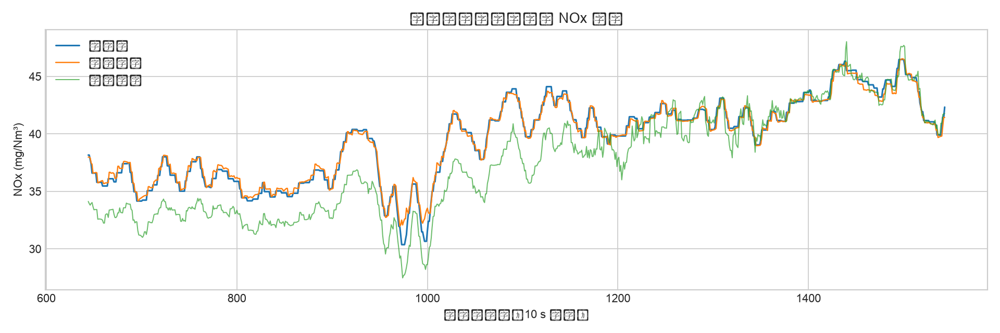
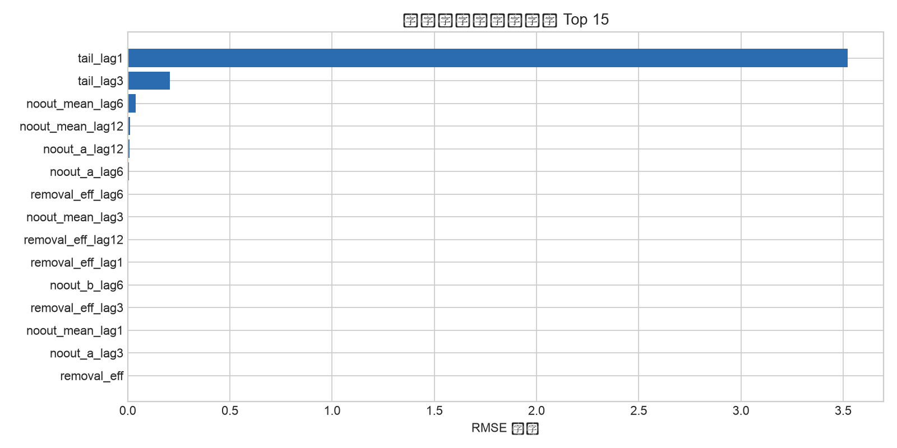
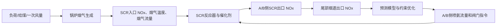

# 基于 DeepSeek 辅助的 600 MW 机组 SCR 脱硝过程数据驱动建模与控制

## 摘要

本项目使用靖海电厂 1 号 600 MW 机组脱硝实测数据，完成数据清洗、10 s 时间聚合、动态滞后特征构造、传统机器学习、深度学习和约束喷氨优化。研究对象为尾部烟道出口 NOx 浓度，输入包含 SCR 入口/出口 NOx、A/B 侧氨气流量与阀门指令、机组负荷、风量、燃料量、一次风量、入口温度和运行状态。

## 1. 任务理解与工艺对象

SCR 是大时延、强耦合、非线性过程。主要控制通道为 A/B 侧喷氨流量或阀门指令，主要扰动通道为机组负荷、烟气流量、入口 NOx、入口温度和燃料/一次风量。控制目标是在满足尾部 NOx 排放约束的同时，减少不必要的氨耗。

## 2. 数据与预处理

- 原始记录：108,001 行，1 s 采样，时间范围为 2024-09-26 12:17:16 至 2024-09-27 18:17:16。
- 预处理：将 327.67 视为分析仪上限哨兵值；负氨流量视为无效；重复标签合并；对数值信号按 10 s 取中位数；仅使用负荷不低于 100 MW、入口/出口信号和温度有效的稳定工况。
- 清洗后：10,314 个 10 s 样本，占聚合数据 95.49%。
- 数据划分：按时间顺序 70% 训练、15% 验证、15% 测试，不随机打乱，防止时间泄漏。

## 3. 建模方法

### 3.1 传统机器学习

建立岭回归、ExtraTrees、随机森林和 HistGradientBoosting 基线。随机森林使用 160 棵树、滞后 10/30/60/120/240 s 特征，目标为尾部烟道出口 NOx。

### 3.2 深度学习

建立双层 GRU，使用最近 360 s 的 10 s 序列窗口预测下一时刻 NOx。GRU 训练时排除了少量尾部 NOx 大于 120 mg/Nm3 的启动/切换异常窗口，以提高稳定工况预测的鲁棒性。

### 3.3 融合

最终保留随机森林主通道和 GRU 时序通道，使用 95% 随机森林 + 5% GRU 的保守加权融合，并将随机森林作为控制优化的主预测器。

## 4. 测试集结果

| 模型 | MAE | RMSE | R² | SMAPE |
|---|---:|---:|---:|---:|
| 持续性基线 | 0.158 | 0.342 | 0.9888 | 0.42% |
| 岭回归 | 0.849 | 0.912 | 0.9199 | 2.28% |
| ExtraTrees | 0.663 | 0.760 | 0.9443 | 1.74% |
| 随机森林 | 0.302 | 0.414 | 0.9835 | 0.80% |
| 双层 GRU | 1.005 | 1.156 | 0.8714 | 2.61% |
| 95/5 融合 | 0.322 | 0.429 | 0.9823 | 0.86% |

随机森林在当前稳定工况测试集上表现最好，测试集 RMSE 为 0.414 mg/Nm3，R² 为 0.9835。持续性基线已较强，说明 10 s 聚合后的尾部 NOx 具有明显惯性；因此模型结果应理解为短时预测与控制辅助，而不是替代分析仪。

## 5. 变量重要性

置换重要性前十项为：

- `tail_lag1`：3.5218
- `tail_lag3`：0.2050
- `noout_mean_lag6`：0.0377
- `noout_mean_lag12`：0.0124
- `noout_a_lag12`：0.0097
- `noout_a_lag6`：0.0059
- `removal_eff_lag6`：0.0033
- `noout_mean_lag3`：0.0030
- `removal_eff_lag12`：0.0021
- `removal_eff_lag1`：0.0021

其中尾部 NOx 的 10 s/30 s 历史值、A/B 侧出口 NOx 的历史值和脱硝效率历史值最重要，符合 SCR 过程的大时延和惯性特征。

## 6. 约束喷氨优化

以随机森林为数字孪生预测器，在当前 A/B 侧氨流量的 0.80–1.20 倍范围内进行网格搜索，约束预测尾部 NOx 不高于设定值加 2 mg/Nm3，并以总氨流量最小为目标。当前时刻的离线推荐结果保存在 `artifacts/control_recommendation.json`，网页可交互重算。该结果仅用于离线分析，正式投运前应加入氨逃逸、阀门速率、最小喷氨量和联锁条件。

## 7. DeepSeek API 的使用方式

数值清洗、模型训练、指标和控制优化全部由本地程序完成。DeepSeek API 只接收脱敏后的统计摘要、特征重要性和模型指标，用于生成数据质量解释、异常工况说明和运行建议。配置 `DEEPSEEK_API_KEY` 后可在网页中调用 `/api/deepseek`；密钥只保存在后端环境变量中。

## 8. 工艺与控制框图

## 9. 结论与限制

本项目完成了课程设计要求中的数据分析、数据对齐、预处理、神经网络/机器学习建模、精度评价、工艺变量分析和控制辅助设计。当前数据为单台机组约 30 h 的 1 s 记录，且存在分析仪上限哨兵值和启停/切换段，因此结论主要适用于负荷不低于 100 MW 的稳定工况。后续若要上线控制，应补充氨逃逸实测值、催化剂活性、烟气流量标定和多时间段数据，并在 Simulink 或实时仿真平台做闭环和抗扰验证。
